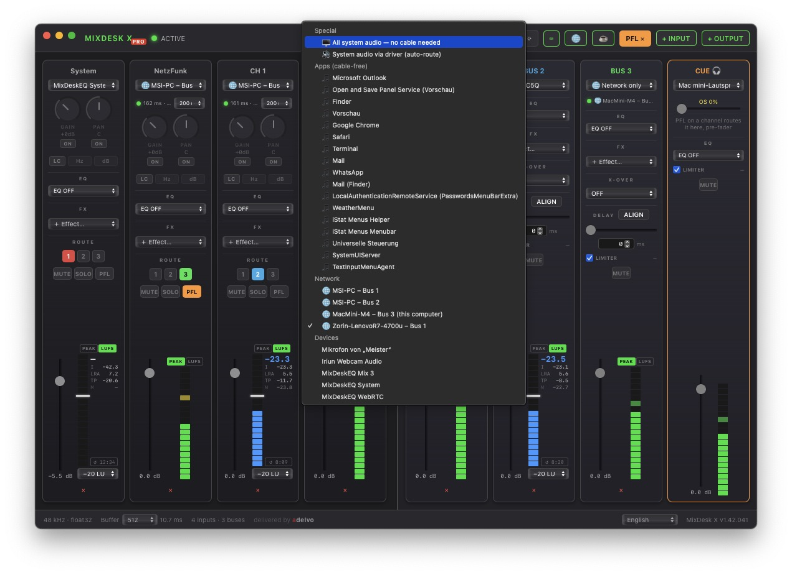
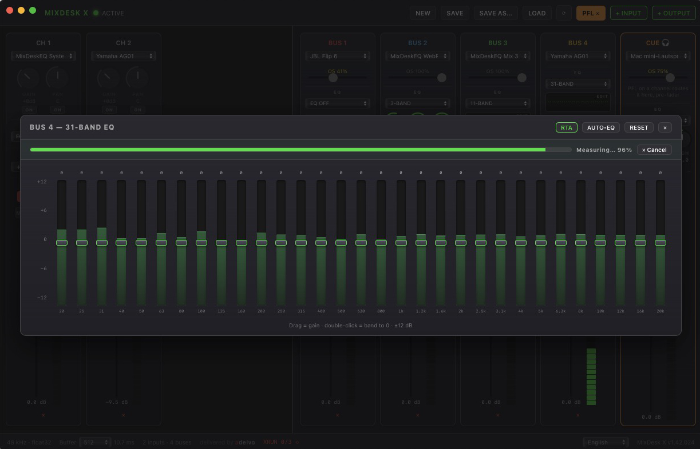
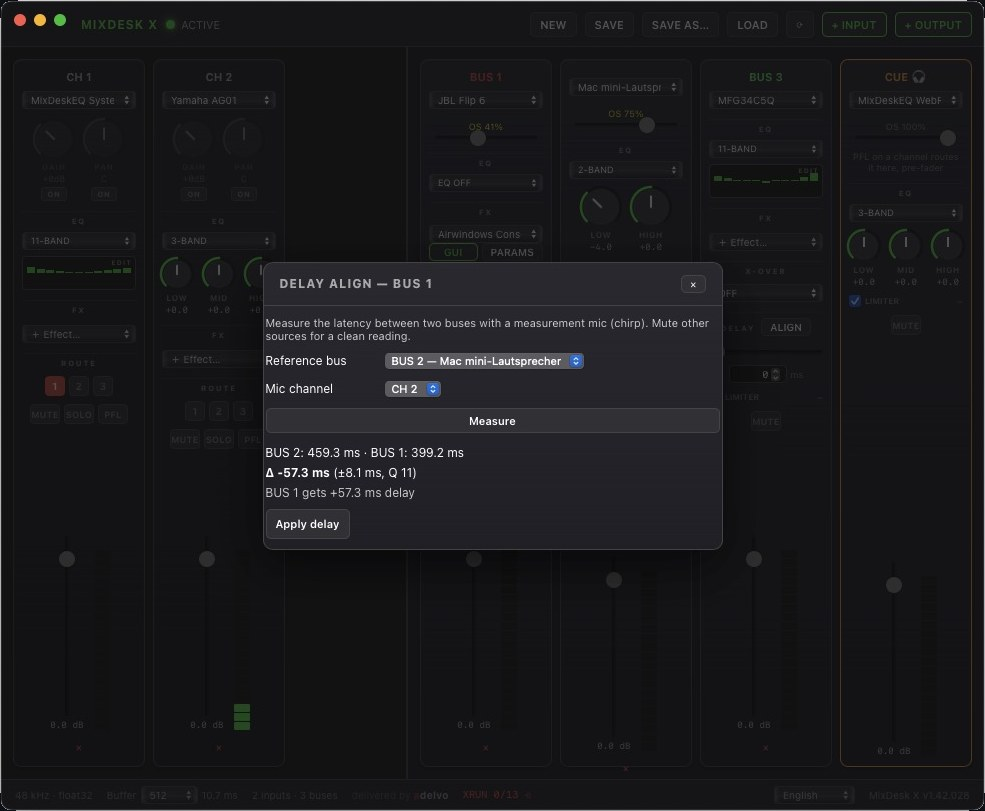
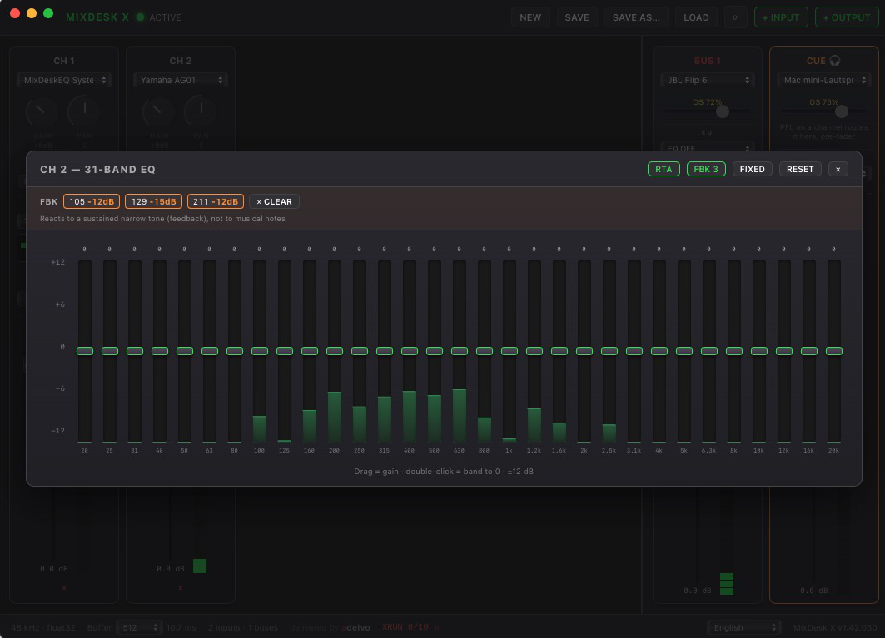
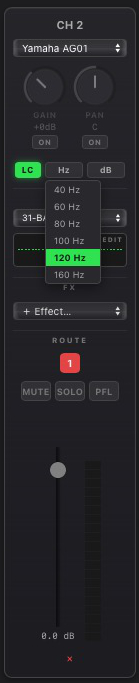
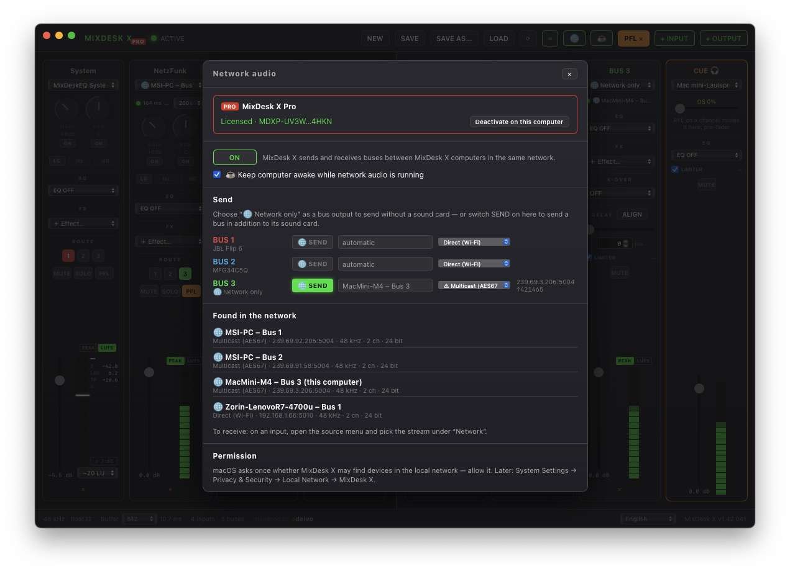

# MixDesk X

 

**Free multi-device audio mixer & router for macOS, Windows and Linux (beta).**
Route any input to any output, EQ everything, split active sub/top systems with real crossovers, **measure and align output delays with a mic**, and chain studio-grade effects — in a lightweight tray app.

## Download

**[⬇ Latest release](../../releases/latest)** — free, no account, no ads. If it helps you: **[♥ leave a tip on Ko-fi](https://ko-fi.com/adelvo)**.

| Platform | File |
|---|---|
| macOS (Apple Silicon) | `MixDesk-X-x.xx.xxx.dmg` — signed & notarized |
| Windows 10/11 x64 | `MixDesk-X-x.xx.xxx-amd64-installer.exe` — signed |
| Windows 11 ARM64 | `MixDesk-X-x.xx.xxx-arm64-installer.exe` — signed |
| Linux x64 (beta) | `mixdesk-x-x.xx.xxx-amd64.deb` — Ubuntu 22.04 base (Zorin OS 17, Linux Mint 21 …): `sudo apt install ./mixdesk-x-x.xx.xxx-amd64.deb` |

**Linux is new (beta, since 1.42.041):** built and tested on Zorin OS, including network audio with Mac and Windows. The current Linux build is 1.42.041 (attached to that release). Feedback via issues is welcome.

## What it does

Think of it as a compact Mackie-style console between all your audio devices:

- **Inputs → Buses, any combination.** Add any capture device (USB mic, webcam mic, interface, loopback/virtual cable) as an input strip and route it to **up to 16 output buses** — enough for program, zone outputs and per-guest mix-minus feeds at the same time.
- **Cable-free system & per-app capture, both platforms:** grab **all system audio** or **a single app** (Spotify, browser, a game …) as an input strip — no virtual cable, no driver. Windows 10 2004+ uses WASAPI Process Loopback (the same API as OBS's Application Audio Capture, no permission needed); macOS 13+ uses ScreenCaptureKit (one-time Screen Recording permission). MixDesk X excludes its own output automatically on both, so capturing can't feed back.
- **Per-input strip:** Gain and Pan (switchable in/out of the signal path), 2/3/11/31-band EQ with graphic editor, CLAP effect chain, Mute/Solo/**PFL**, fader, VU meter.
- **Per-bus strip:** its own output device, EQ, CLAP effect chain, **delay 0–1000 ms**, transparent safety limiter with gain-reduction meter, fader, VU — plus an **OS volume slider** (macOS) that reveals and rides the hidden per-device system volume behind the fader.
- **Multichannel interfaces — every pair, in and out (new in 1.42.042):** on devices with more than two channels, each input strip picks its own **stereo pair (1+2, 3+4 …) or single mono input**, and each bus its own **output pair or mono output** — PA on 1+2, headphones on 3+4, stream on 5+6, all from one interface (tested with a 56-channel aggregate). **macOS aggregate devices** work with all their sub-devices, also at different sample rates (e.g. a Bluetooth speaker at 44.1 kHz, converted with a high-quality resampler), and the OS volume slider follows the sub-device. On Windows, VB-Cable set to 7.1 becomes four stereo lines. Pairs 1+2 are free; from 3+4 upward it's part of MixDesk X Pro.
- **IR export for guitarists (Pro, new in 1.42.042):** measure your speaker with AUTO-EQ and export the 31-band correction as an impulse response (24-bit mono WAV, minimum phase, 44.1/48/96 kHz) for your amp modeler or IR loader — it then runs there with no extra latency. Optionally merged into your existing cab IR for loaders with a single IR slot.
- **PFL & cue — a real headphone section:** the orange **CUE strip** is an *extra* output (its own device, correction EQ, safety limiter, mute — no bus consumed). Hit **PFL** on any channel to hear it **pre-fader** on the cue — even while it's muted. The classic "is there even signal?" check before you push a fader up; **PFL ✕** in the header clears everything with one click.
- **31-band EQ, RTA & Auto-EQ (software DriveRack):** every strip's EQ scales up to 31 bands with a **real-time ⅓-octave analyzer**; buses can run a pink-noise measurement and **auto-EQ the room**, with UMIK-1/REW mic-calibration file support.

- **Active crossovers per bus (X-OVER):** split any signal into sub/top or full 3-way systems — **LP · SUB**, **HP · TOP** and **BP · MID** (bandpass with two crossover frequencies), with **Linkwitz-Riley slopes of 12/24/48 dB/oct**. Each way runs on its own bus and output device: your computer is now also the speaker processor.
- **Measured delay alignment (ALIGN):** stop guessing latency. A measurement chirp plays through a reference bus and the selected bus, any input channel (your measurement mic) picks it up, and an FFT matched filter locates it sample-accurately — **one click applies the delay** to the earlier way. Made for Bluetooth speakers, whose latency changes on every reconnect; works for crossover ways too.

- **Feedback destroyer & low-cut (mic tools):** arm an automatic **feedback destroyer** per microphone channel — it watches for a sustained feedback tone sitting on one exact frequency and drops a narrow notch on it, with a **LIVE** mode (adaptive, releases when the frequency goes quiet) and a **FIXED** mode for ringing out a soundcheck. And a switchable **low-cut / rumble filter** on every input (40–160 Hz, 12 or 24 dB/oct) strips mic rumble, handling noise and low-frequency feedback with zero latency. The honest split: the low-cut kills the lows, the destroyer handles the mid-range whistles.

- **Loudness metering (LUFS):** every input and output meter switches between PEAK and **LUFS** (ITU BS.1770 / EBU R128) — Momentary, Short-term, Integrated, loudness range and true peak, with a target line (−23 … −14 LUFS). Peak hold on all meters and in the RTA.
- **Remote control — hotkeys, HTTP, Stream Deck:** behind the **⌨** button left of *+ INPUT*:
  - **Global keyboard shortcuts** per input and output for **mute, louder and quieter** — freely assignable like in OBS, working while MixDesk X is in the background (macOS and Windows). Hold for a smooth fade.
  - **Local HTTP control** (off by default, optionally network-wide): `/api/ch/<name>/mute`, `/up`, `/down`, `/volume?db=-10`, `/api/bus/<n>/…`, `/api/state`.
  - **Companion export** for Stream Deck Mini, 15, XL, + and + XL with **live level, peak hold and mute state on the keys** (Generic HTTP module, no extra module). On the Stream Deck + every dial is a channel.
  - **Names are the address:** rename a channel (click *CH 1*) and use that name in the URL — rename first, then export.
- **Network audio between MixDesk X computers — MixDesk X Pro:** send any bus over the network and pick it as an input on another Mac, Windows or Linux computer — several computers in a chain, in any direction. **Direct** (default) gives every receiver its own packets and runs robustly over cable, Wi-Fi and mesh; **multicast in AES67 format** is there for wired networks (after a confirmation — tested between MixDesk X computers, not yet with AES67/Dante hardware; feedback or loan hardware welcome). Streams find each other automatically, clock drift between the computers is compensated with a high-quality resampler, ~2.3 Mbit/s per stereo stream, buffer 20–200 ms per input. The computer stays awake while network audio runs. **$19 one-time for 2 computers, 14-day free trial** — set up via the 🌐 button. The same Pro license covers multichannel pairs from 3+4 and the IR export; everything else in MixDesk X stays free.

- **Speaker sync:** the per-bus delay (0–1000 ms) aligns a Bluetooth speaker with wired speakers playing the same source — multi-room without the echo. Set it by hand, or let **ALIGN** measure it for you.
- **CLAP plugin host:** stack multiple effects per strip (each slot its own instance), open the plugin's **native GUI**, or use the built-in generic parameter editor. One click installs the free [Airwindows Consolidated](https://github.com/baconpaul/airwin2rack) pack (~400 effects).
- **Mic processing for calls & streams:** EQ/compress your USB or webcam mic and feed it to Discord, Zoom, or OBS through a virtual device — see [Virtual audio devices](#virtual-audio-devices) below.
- **Presets:** save/load complete mixer setups; the last preset loads automatically at startup.
- **16 UI languages:** English, Deutsch, Español, Français, Italiano, Português (BR), 日本語, 한국어, 中文, Suomi, Svenska, Polski, Čeština, Dansk, Nederlands, Română. The console labels (MUTE, SOLO, PFL, EQ …) stay in classic mixer English — like on hardware consoles worldwide.
- **Stays out of your way:** tray/menu-bar app, compact mini mixer (macOS), XRUN monitor in the footer, automatic stream recovery when devices disappear or glitch.
- **Low latency:** buffer size selectable 128–2048 frames, 44.1/48/96 kHz, float32 engine end to end.

## Quick start

1. Install and launch — MixDesk X lives in your tray / menu bar.
2. **+ INPUT** → pick your source (mic, loopback device, virtual cable).
3. **+ OUTPUT** → pick where it should go (speakers, headphones, virtual cable).
4. Click the bus numbers on the input strip to route it. Done — now add EQ, effects, delay to taste.

### Example: EQ a single app, cable-free (Windows & macOS)

1. **+ INPUT** → group **Apps (cable-free)** → pick the app (Windows lists apps while they play audio; macOS lists running apps and asks once for the Screen Recording permission — restart the app after granting).
2. Route it to a bus on your speakers/headphones — EQ and effects apply to just that app.

For **all system audio** pick **🖥 All system audio — no cable needed** instead. Heads-up: this is a *tap*, not a redirect — apps also keep playing on the default output. If you hear everything twice, set the default output to an unused device (the captured signal is device-independent and keeps flowing); on macOS the **"System audio via driver"** route silences the direct path instead.

### Example: EQ'd mic into Discord (Windows)

1. Install [VB-Audio Virtual Cable](https://vb-audio.com/Cable/) (free).
2. Input strip: your USB/webcam mic → EQ + effects.
3. Output bus: device = **CABLE Input**.
4. Discord → Voice settings → Input device = **CABLE Output**.

On macOS use the [MixDeskEQ audio driver](https://github.com/adelvo-software/mde-audio-drivers) or [BlackHole](https://github.com/ExistentialAudio/BlackHole) the same way.

## Virtual audio devices

MixDesk X routes between real devices out of the box and **captures system/app audio natively on both platforms** (see above — no device needed). A virtual device is only needed to feed MixDesk X's *output* into another app (mic → Discord/Zoom/OBS), or for the driver-based macOS system route that silences the direct playback path:

| OS | Driver | Notes |
|---|---|---|
| macOS | **[Adelvo audio drivers](https://github.com/adelvo-software/mde-audio-drivers)** | Recommended — an installer built on the excellent open-source [BlackHole](https://github.com/ExistentialAudio/BlackHole) (GPL-3.0) that sets up **multiple** stereo loopback devices in one go. Plain BlackHole gives you a single stereo device; multi-bus routing usually needs two or more. The built-in **“System audio via driver”** input option auto-routes your system output through it, one click. |
| macOS | [BlackHole 2ch](https://github.com/ExistentialAudio/BlackHole) | The underlying loopback driver — fine if one stereo loop is all you need. |
| Windows | [VB-Audio Virtual Cable](https://vb-audio.com/Cable/) | Free version = **one** cable (enough for mic → Discord). CABLE Input = MixDesk X output bus, CABLE Output = mic in Discord/OBS. The **“System audio via VB-Cable (auto-route)”** input option routes your Windows default output through it, one click. |
| Windows | [VB-Cable A+B / C+D](https://vb-audio.com/Cable/) or [VoiceMeeter](https://vb-audio.com/Voicemeeter/) | Need more loops (e.g. mic → Discord **and** a parking spot for the default output)? A+B/C+D are donationware add-on cables; VoiceMeeter (free) also adds multiple virtual devices. VB-Audio's license does not allow bundling, so these are separate installs. |

## Requirements

- **macOS 13+** (Apple Silicon)
- **Windows 10/11** (x64 or ARM64)
- **Linux x64 (beta)** — Ubuntu 22.04-based distributions (needs libwebkit2gtk-4.0); system audio via PulseAudio/PipeWire
- CLAP plugins are optional; scanned from the standard CLAP folders

## License

MixDesk X is **freeware** (binary distribution, closed source) — free for personal and commercial use. **MixDesk X Pro** is the optional paid add-on for network audio, multichannel input/output pairs from 3+4 and the IR export (14-day free trial); everything else stays free. Tips for the free version are welcome on [Ko-fi](https://ko-fi.com/adelvo) — they unlock nothing, everything free stays free. See [EULA.md](EULA.md). CLAP plugins are third-party software under their own licenses.

---

## More from Adelvo

*Meet **Karma**, the Adelvo mascot — click for the video.* 🐾

**[Directors Plan for vMix](https://adelvo.io/directors-plan)** — *One person plans. Someone else hits Play.* Professional rundown, frame-accurate automation & control for vMix live productions. Press Play and transitions, overlays and timings fire on cue — with **live override during playback**, because live is live. macOS & Windows · 20+ languages · 30-day free trial.

**[LLT — Local Live Translator](https://adelvo.io/local-live-translator)** — *Translate, transcribe, dictate — output almost anywhere.* The whole pipeline runs **100% local on Apple Silicon** (Whisper · Parakeet · Mistral) — then goes live to OBS, VRChat or vMix in your own design. 101 languages, zero cloud dependency, free iOS companion app.

**[Volume Balance](https://adelvo.io/volume-balance)** — kills the #1 annoyance on social media: wildly different volume levels between videos. Right in your browser (Chrome · Firefox · Safari).

Made by [Adelvo](https://adelvo.io).
